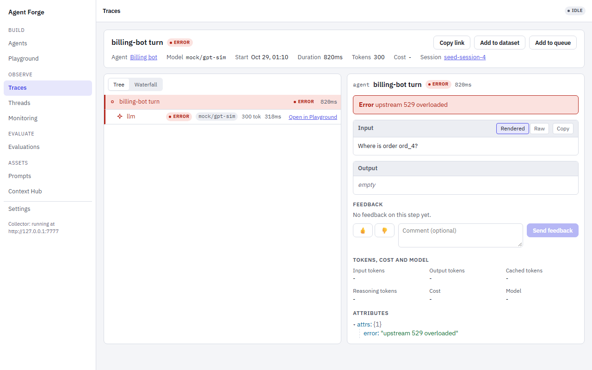

<div align="center">
  <a href="https://lousho.com">
    <picture>
      <source media="(prefers-color-scheme: dark)" srcset=".github/assets/lousho-dark.svg">
      
    </picture>
  </a>

# Lousho — TypeScript AI agent SDK

[](https://www.npmjs.com/package/lousho)

[](https://lousho.com)
[](LICENSE)
[](https://www.npmjs.com/package/lousho)
[](https://github.com/LinuxDevil/agent-sdk)

</div>

TypeScript AI agents you can test in CI, pause for approval, and resume after a crash. Runs in your own Node process.

<div align="center">
  <a href="https://lousho.com/agent-forge">
    <picture>
      <source media="(prefers-color-scheme: dark)" srcset="docs/images/studio-trace-dark.png">
      
    </picture>
  </a>
  <br>
  <sub>Agent Forge, the local studio. Open it with <code>npx lousho studio</code>.</sub>
</div>


## Why Lousho

- **Test agents in CI without an API key.** `lousho eval` records a real run once, replays it with no network, and reports when the tool-call trajectory drifts. [Evals](https://lousho.com/evals)
- **Resume after a crash.** Give the agent a store and `agent.resume()` finishes an interrupted run. Tool calls that already have a result do not run again. [Durable execution](https://lousho.com/durable-execution)
- **Pause for a human.** A tool marked `needsApproval` pauses the run. Another request, or with a durable store another process, can approve it later, and the run continues where it stopped. [Approvals](https://lousho.com/approvals)
- **Runs in your own Node process.** There is no hosted runtime. `lousho build` targets a Node server, Docker or Cloudflare Workers, and `lousho studio` runs on your machine. [Deployment](https://lousho.com/deployment)
- **Works with the Vercel AI SDK.** `fromAiSdk()` and `fromAiSdkTools()` wrap AI SDK models and tools, so you can move over one piece at a time. [Migrating from the AI SDK](https://lousho.com/migrating-from-ai-sdk)

## Try it in 60 seconds, no API key

You need Node.js 22.19 or newer and a network connection to install packages. You do not need an API key.

```bash
npm create lousho@latest my-agent -- --yes
cd my-agent
npm test
```

`--yes` picks the defaults: the minimal template and the OpenAI provider. `npm test` runs the project's tests on a mock model, offline.

Now add an eval. Save this as `src/weather.eval.ts`:

```ts no-run
import { createAgent, defineEval, defineTool } from 'lousho';
import { mockModel } from 'lousho/testing';
import { z } from 'zod';

const getWeather = defineTool({
  name: 'get_weather',
  description: 'Current weather for a city',
  input: z.object({ city: z.string() }),
  execute: async ({ city }) => ({ city, tempC: 21, sky: 'sunny' }),
});

defineEval({
  name: 'weather advice',
  agent: () =>
    createAgent({
      instructions: 'Check the weather before giving advice.',
      tools: [getWeather],
      provider: mockModel([
        { toolCalls: [{ name: 'get_weather', args: { city: 'Lisbon' } }] },
        { text: 'It is sunny and 21°C. Wear a T-shirt.' },
      ]),
    }),
  async test(t) {
    await t.send('What should I wear in Lisbon today?');
    t.completed();
    t.calledTool('get_weather', { args: { city: 'Lisbon' } });
    t.maxSteps(4);
  },
});
```

Then run it:

```bash
npx lousho eval
```

```text
EVAL            CASE  RESULT  SCORES  DURATION
weather advice  -     PASS    -       14ms

1 eval(s): 1 passed, 0 failed, 0 with soft failures (14ms)
```

To test against a real model, use `model: 'openai/gpt-4.1-mini'` in place of `provider`, set your key and record once. This step needs the key. Commit the cassettes it writes. CI then replays them with no network and no key:

```bash
npx lousho eval --record
npx lousho eval --replay
npx lousho eval --drift
```

`--drift` re-records each case and shows where the tool calls, arguments or step count changed. See [Record, replay and drift](https://lousho.com/evals#record-replay-and-drift).

## How it compares

| | Lousho |
| --- | --- |
| Where it runs | In your own Node process. No hosted runtime. |
| Tests without an API key | `mockModel` scripts, and recorded cassettes that `lousho eval --replay` plays back offline |
| Crash recovery | `agent.resume()` on memory, file, SQLite or Cloudflare KV stores |
| Human approval | `needsApproval` pauses the run; with a durable store, another process can resume it |
| License | MIT |

For a side-by-side look at the Vercel AI SDK, OpenAI Agents SDK, Mastra and LangGraph.js, see the [comparison page](docs/comparison.md).

## Installation

Requires Node.js 22.19 or newer. To start a new project, see [Try it](#try-it-in-60-seconds-no-api-key) above. To chat with that agent, copy `.env.example` to `.env`, put your API key in it and run `npm run dev`.

To add Lousho to an existing project:

```bash
npm install lousho ai@^7.0.0 zod @ai-sdk/openai@^4.0.0
```

See [Installation](https://lousho.com/installation#provider-packages) for other providers. `npx lousho doctor` checks your setup and prints a fix for anything missing.

## Quickstart

This file uses top-level `await`, so it must be an ES module (`.mts`, or `"type": "module"` in `package.json`). Set `OPENAI_API_KEY` to run it.

```ts
import { createAgent, defineTool } from 'lousho';
import { z } from 'zod';

const getWeather = defineTool({
  name: 'get_weather',
  description: 'Current weather for a city',
  input: z.object({ city: z.string() }),
  execute: async ({ city }) => ({ city, tempC: 21, sky: 'sunny' }),
});

const agent = createAgent({
  model: 'openai/gpt-4.1-mini',
  instructions: 'You are a travel assistant. Check the weather before giving advice.',
  tools: [getWeather],
});

const { text } = await agent.send('What should I wear in Lisbon today?');
console.log(text);
```

### Agent folders

An agent can also be a folder, which you run with `npx lousho dev ./my-agent`:

```text
my-agent/
├── agent.json          # Optional: model, permissions, limits
├── instructions.md     # The system prompt
├── tools/              # defineTool() tools
└── skills/             # Instructions loaded on demand
```

Loading a folder runs its code, so only load ones you trust. See [Agent directories](https://lousho.com/agent-directories).

## Features

- **MCP**: connect to MCP servers, or serve your agent as one. [MCP](https://lousho.com/mcp-integration)
- **Multi-agent**: [sub-agents](https://lousho.com/sub-agents) that run in parallel, and [handoffs](https://lousho.com/handoffs) to specialists.
- **UI**: bindings for [React](https://lousho.com/react), [Vue](https://lousho.com/vue) and [Svelte](https://lousho.com/svelte), plus [AI SDK `useChat`](https://lousho.com/ai-sdk-ui) and [Next.js routes](https://lousho.com/nextjs).
- **Tracing**: OpenTelemetry GenAI spans and a local trace viewer. [Observability](https://lousho.com/observability)
- **Agent Forge**: `lousho studio` opens a local visual canvas, run debugger and chat. [Agent Forge](https://lousho.com/agent-forge)
- **Self-healing (experimental)**: `lousho improve` turns an agent's failed runs into tested edits to its instructions and skills, applies one that passes (or queues it for a person), and rolls it back on a regression. [Self-healing](docs/self-healing.md)
- **Coding agents**: workspace tools, permission rules and starter kits from `lousho add`. [Build a coding agent](https://lousho.com/build-a-coding-agent)

## Documentation

The full guides are at [lousho.com](https://lousho.com), in English and Arabic. Good places to start: [Quick Start](https://lousho.com/quickstart), [Tools](https://lousho.com/tools), [Providers](https://lousho.com/providers), [CLI](https://lousho.com/cli) and [Troubleshooting](https://lousho.com/troubleshooting).

Coding agents can read the docs from `node_modules/lousho/docs`, indexed by [`llms.txt`](llms.txt). The repo also has every page in one file, [`llms-full.txt`](llms-full.txt).

## Examples

Most examples run offline with a mock provider. The [examples index](examples/README.md) has the full list and how to run each one. A few to start with:

- [ops-pipeline](examples/ops-pipeline): monitor alert, Slack button, human approval, fixer agent, gated GitHub PR
- [coding-harness](examples/coding-harness): a coding agent with checkpoints, permission rules and a loop guard
- [deep-research](examples/deep-research): parallel researcher sub-agents and a cited report
- [support-desk](examples/support-desk): triage handoffs and an approval-gated refund tool

## Status

Alpha. The API may change before 1.0. Pin a version. [Upgrading](docs/upgrading.md) covers the breaking changes between alphas and how to move your code.

## Community

- Questions and ideas: [GitHub Discussions](https://github.com/LinuxDevil/agent-sdk/discussions).
- Bugs and feature requests: [GitHub issues](https://github.com/LinuxDevil/agent-sdk/issues).
- Arabic docs: [lousho.com/ar](https://lousho.com/ar).

## Contributing

Contributions are welcome. See [CONTRIBUTING.md](CONTRIBUTING.md) for setup and the checks a pull request must pass. To report a vulnerability, see [SECURITY.md](SECURITY.md).

## License

MIT © [Ali Mohammad](LICENSE)
