# Agent Forge

Agent Forge (`apps/agent-forge`, also called the Studio) is this SDK's
companion dashboard: one app with a left navigation to build and run agents,
try prompts, and read what your agents did from the observe daemon. Build an
agent's graph on a canvas, run it, chat with it and author sandboxed
pre/post hooks (all reading and writing the same `AgentSpec` YAML that
`lousho dev` and `lousho build` use), try prompts in a playground, and read
the [observe daemon](./observability.md#the-observe-daemon)'s traces,
threads, fleet monitoring, eval scores, datasets, annotation queues, prompt
registry and context hub. It's launched with one command,
`lousho studio`, and ships as part of this SDK's npm package.

This doc covers: installation, the `lousho studio` quickstart, the
[navigation and screens](#navigation), a first-agent walkthrough, hook
authoring, time travel (replaying a run from a past step), the playground
endpoint, and how settings/secrets/deploy wiring works.

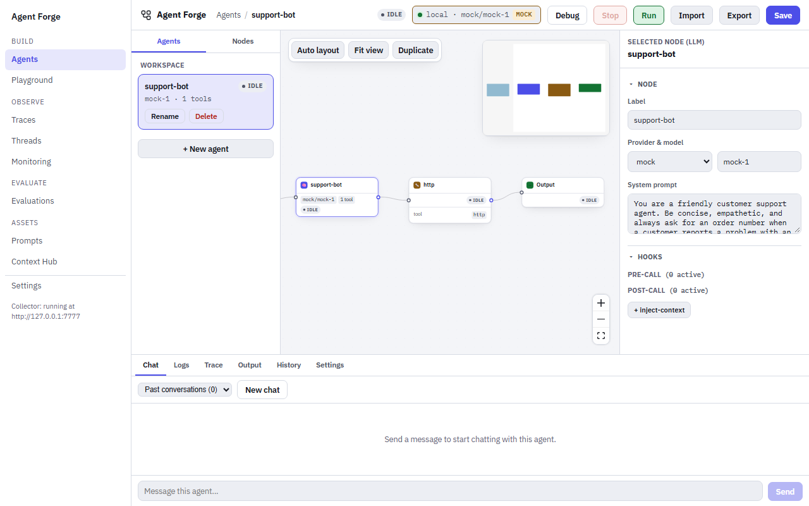

## Installation

Agent Forge ships inside `@lousho/build-ai-agent` itself - there's no
separate package to install:

```bash
npm install @lousho/build-ai-agent
```

That's it. `lousho studio` (below) runs a pre-built copy of the app; you
don't need `apps/agent-forge`'s own source or its devDependencies (Vite,
`tsx`, etc.) to use it.

If you're working inside this SDK's own monorepo instead (contributing to
Agent Forge itself), see [Dev mode](#dev-mode) below.

## Quickstart

```bash
npx lousho studio
```

This starts one local server and prints its URL (default
`http://127.0.0.1:4750/?token=<random>`). Open that exact URL in a browser.
It lands on the Agents screen (`#/agents`): the left navigation, the build
toolbar (the agent's name and run status, the model badge, then Debug, Stop,
Run, Import, Export and Save), the
agent rail (your saved agents plus a node/hook palette), the canvas, the
Inspector (right), and a bottom drawer with Chat, Logs, Trace, Output,
History and Settings tabs. An agent opens with nothing selected and the
whole graph fitted in view; the Inspector stays folded away until you
select a node, or press **Show inspector** (the panel icon at the canvas's
top-right), which is remembered. The other screens are one click away in the
navigation; see [Navigation](#navigation).

Below 860px wide the navigation becomes a drawer opened from the
**Navigation** (menu) button at the top; picking a screen, the scrim or Esc
closes it. On the Agents screen the agent rail and the Inspector become
slide-over panels you open from the top bar; Run (or Stop) and Save stay in
the bar, and Debug, Import, Export and the model badge move into its **More
actions** (`⋯`) menu.

Useful flags:

```bash
npx lousho studio --port 5000       # pick a different port
npx lousho studio --host 0.0.0.0    # bind to all interfaces
npx lousho studio --prod            # force production mode (see below)
npx lousho studio --dev             # force dev mode (monorepo only)
```

### Access token

The studio can store provider keys, start runs and execute hook code, so its
API is locked to the browser tab you opened from the printed URL:

- Each launch mints a random token and prints it in the URL (`?token=...`).
  The page keeps it for that tab (it survives a reload) and sends it on
  every API call (`x-lousho-studio-token` header) and on the WebSocket
  (`?token=` query). A request without it gets `401`. Opening the bare
  `http://127.0.0.1:4750` in a new tab loads the page, but its API calls
  fail until you use the printed URL.
- The server sends no CORS headers and refuses (`403`) a request whose
  `Origin` is not the studio's own, or whose `Host` is not a loopback name
  (`localhost`, `127.0.0.1`, `[::1]`) or the `--host` you bound to. With
  `--host 0.0.0.0` any `Host` is accepted and the token is the only gate.
- `GET /health` and the static client need no token.

From `curl`, pass the token: `curl -H "x-lousho-studio-token: $TOKEN" localhost:4750/agents`.

`lousho studio` hands these to the processes it starts through environment
variables; you only set them yourself when you start the studio server
without the CLI:

| Variable | Read by | Meaning |
| --- | --- | --- |
| `LOUSHO_STUDIO_TOKEN` | the studio API server | The access token. Unset, the server mints a random one per launch. |
| `LOUSHO_STUDIO_ALLOWED_ORIGINS` | the studio API server | Comma-separated extra origins to accept besides the studio's own (dev mode sets the Vite dev server's). |
| `LOUSHO_STUDIO_API_URL` | the Vite dev server (dev mode) | Where to proxy API calls (default `http://127.0.0.1:4750`). |

### Where agents live

Agent specs and run state are stored under `.lousho/` in the directory you
ran `lousho studio` from (agent YAML files under `.lousho/agents/`,
checkpoints and approvals alongside them) - the same `.lousho/` layout
`lousho dev`/`lousho build` use.

The Agents screen's agent rail lists exactly the agents in that `.lousho/agents/`: a YAML
file you add there shows up, and an agent you create in the studio is
written there at once (autosave and **Save** both write the file), so it
can be chatted with straight away. Another project, opened in its own
`lousho studio`, shows only its own agents. The browser keeps nothing but a
draft of an edit that could not reach the server (it is pushed on the next
load), stored per workspace directory. A file in `.lousho/agents/` that no
longer parses is skipped with a warning in the server log.

### Production vs. dev mode

`lousho studio` has two modes, and picks the right one automatically:

- **Production** (the default once Agent Forge has been built): a single
  Express server serves both the REST/WebSocket API *and* the pre-built
  client (React app) as static files, on one port. This is what runs when
  you `npm install` the published package - there's no separate Vite dev
  server and no TypeScript loader involved.
- **Dev** (falls back to this if the build hasn't been run yet, i.e. inside
  a source checkout of this monorepo): the API server runs straight off
  its TypeScript source via `tsx`, alongside a real Vite dev server (with
  hot-module reload) that proxies API requests to it. Two processes, two
  ports internally, one command.

`--prod`/`--dev` force one or the other; run without either flag and
`lousho studio` auto-detects based on whether `apps/agent-forge/dist-server`
exists.

## Navigation

The left navigation lists every screen, grouped:

| Group | Item | Screen |
| --- | --- | --- |
| Build | **Agents** | The builder: canvas, Inspector, bottom drawer. The build toolbar (Run, Stop, Debug, Import, Export, Save, model badge) shows only here. |
| Build | **Playground** | Try messages against a model without editing an agent. |
| Observe | **Traces** | Every run the observe daemon holds, filtered and sorted; a row opens the trace. |
| Observe | **Threads** | Sessions (conversations): one row per session, one turn per run. |
| Observe | **Monitoring** | The fleet's health and charts over a time window. |
| Evaluate | **Evaluations** | Tabs for Scores, Datasets, Evaluators and Annotation queues. |
| Assets | **Prompts** | The prompt registry: versions, labels, diffs. |
| Assets | **Context Hub** | Shared key-values agents publish to the daemon. |
| | **Settings** | Appearance, provider keys, settings profiles, deploy, collector and shortcuts. |

Off the Agents screen a page header names the screen and keeps the live run
status pill (Settings leaves it out). Under Settings, a small card shows the collector status (see
[The collector](#the-collector-observe-daemon)). The button beside the
**Agent Forge** name at the top of the nav (**Collapse navigation**)
shrinks it to a rail of icons; hover an icon for its name. The choice is
remembered across reloads. Below 860px wide the nav is always the full
drawer.

### Routes and deep links

Every screen has a hash route, and a screen's filters live in the URL's
query string, so a reload, a bookmark or a pasted link opens the same screen
with the same filters. Defaults are never written (a bare `#/traces` is the
default 24 h list). Filter, sort and page edits replace the current history
entry, and opening a row pushes one, so the browser's Back returns from a
trace to the list instead of walking through filter edits. An empty or
unknown hash goes to `#/agents` (the `?token=` stays).

| Route | Screen | Query keys |
| --- | --- | --- |
| `#/agents`, `#/agents/<agent id>` | Agents, with that agent open | |
| `#/playground` | Playground | `trace` + `fromObs`, or `prompt` (see [Playground](#playground)) |
| `#/traces` | Traces list | `agent`, `status`, `model`, `project`, `q`, `prompt` (`<name>` or `<name>@<version>`), `from` + `to` (ms epoch, half-open), `sort` (`duration`, `tokens`, `cost`) + `order` (`asc`, `desc`), `offset` |
| `#/traces/<trace id>` | One trace | `obs` (the selected step) |
| `#/threads` | Threads list | `agent`, `status`, `from` + `to`, `offset` |
| `#/threads/<session id>` | One thread | |
| `#/monitoring` | Monitoring | `window` (`1h`, `24h`, `7d`, `30d`; default `24h`), `agent` |
| `#/evals/scores` | Scores | `eval` (comma list), `agent`, `source` (`eval`, `judge`, `human`, `online`), `range` (default `30d`), `open` (the expanded eval) |
| `#/evals/datasets`, `#/evals/datasets/<name>` | Datasets, one dataset | `offset` |
| `#/evals/evaluators`, `#/evals/evaluators/<rule id>` | Evaluators, one rule's edit view | `kind` (`code`, `judge`), `enabled` (`true`, `false`), `offset`; on a rule, `trace` (prefills Test on trace) |
| `#/evals/queues`, `#/evals/queues/<queue id>` | Annotation queues, one queue's review | `offset` (the list) |
| `#/prompts` | Prompt registry | |
| `#/prompts/<name>`, `#/prompts/<name>@<version or label>` | One prompt (latest version by default) | `diff=<a>,<b>` |
| `#/hub`, `#/hub/<namespace>` | Context Hub | `agent` (the "Viewing as" agent), `scope` (`private`, `fleet`) |
| `#/settings` | Settings | |

A time range picked from a preset other than the default is written as
absolute `from`/`to` bounds, so a reload shows exactly the same rows. The
full route list is `apps/agent-forge/src/screens/routeTable.ts`.

### Keyboard

| Keys | Does |
| --- | --- |
| `Ctrl+K` / `Cmd+K` | Open (or close) the command palette, anywhere, even while typing. |
| `?` | Show the keyboard shortcuts (not while typing in a field). |
| `j` / `k` | Next / previous row in a focused table. |
| `Enter` | Open the selected row. |
| `Esc` | Close the palette, the shortcut sheet, a header dialog or the narrow nav drawer. |

The command palette lists **Go to** every nav screen, **Open agent**
for each saved agent, and **Toggle theme** (light/dark, remembered in the
browser); type to filter. Paste a trace id (8 or more hex digits and
dashes) and the first entry is **Open trace** for it. Arrow keys move,
Enter runs.

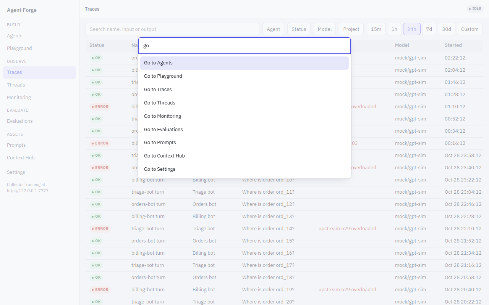

In an annotation queue's review, Enter submits the scores and `S` skips
the item (see [Annotation queues](#annotation-queues)).

### Status words

Every status in the Studio is the same pill:

- Runs: `ok`, `error`, `running`, `interrupted` (the agent's process died
  mid-run; see [The observe daemon](./observability.md#the-observe-daemon)).
- Agents: `healthy`, `stale` (missed heartbeats), `down`, `stopped`.
- Threads: `active`, `ended` (idle, see
  [Idle sessions](./observability.md#idle-sessions)), `interrupted`.
- Scores: `pass`, `fail`.
- Builder runs: `idle`, `running`, `done`, `stopped`, `error`,
  `awaiting approval`.

### The collector (observe daemon)

Everything under Observe, Evaluate and Assets reads the observe daemon
(`lousho observe start`) through the Studio server's `/observe` proxy. The
proxy reads only `LOUSHO_OBSERVE_URL` (default `http://127.0.0.1:7777`);
`LOUSHO_OBSERVE` does not change where the screens read (it only picks where
builder runs report, see the [walkthrough](#first-agent-walkthrough)). When
`LOUSHO_OBSERVE_TOKEN` is set, the proxy sends it to the daemon as the bearer
token on every read and write (as run reporting and the judge evaluators do),
so the screens also work against a daemon started with `--require-token`.
Without it, such a daemon answers `401` to every `/api/` read and the screens
show that error instead of data (`/health` still answers, so the collector
card says running). The browser's own credentials (the Studio token, cookies,
`Authorization`) are never passed on. The proxy only forwards reads plus the
writes the screens make (feedback scores, new prompt versions from the
Playground, prompt label moves, hub entry edits, dataset and example writes,
annotation queue writes, evaluator rule writes); every other write, ingest
above all, is refused with `405`. It always calls the daemon at
`LOUSHO_OBSERVE_URL`, whatever host the request line names.

The collector card at the bottom of the nav says whether the daemon answers:
**Checking collector…** until the first probe, then **Collector running**
or **Collector unreachable**, with the daemon URL underneath. The probe keeps polling. While the daemon is down, each
daemon screen shows the command to start it instead of an error, keeps its
URL, and swaps the data back in by itself once the daemon answers. The
Agents screen and Playground runs do not need the daemon.

## Screens

### Agents

The builder: see the [First-agent walkthrough](#first-agent-walkthrough).
`#/agents/<id>` opens that agent; leaving the screen (or switching agents)
with unsaved changes asks first. Runs started here report to the observe
daemon, and the Run status pill's **Open trace** link opens the run on the
Trace screen.

### Playground

`#/playground` (Build > Playground) tries messages against a model
without editing an agent:

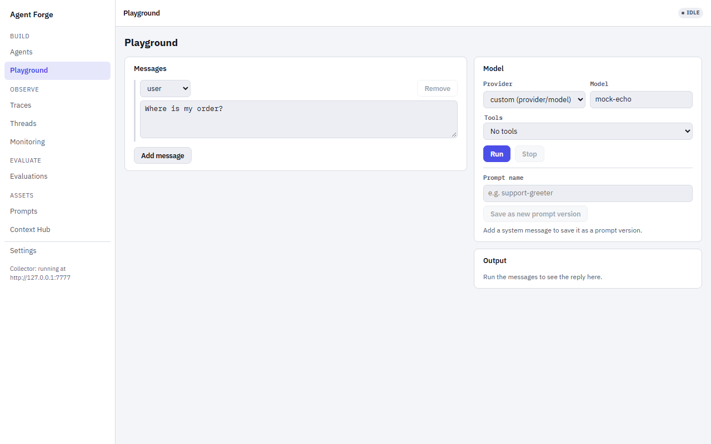

- **Messages**: system, user and assistant message cards. Every `{name}`
  placeholder in any message gets a **Variables** input in the left
  settings card, in the order the names first appear.
- **Model**: a provider (the ones with a key under Settings > Provider keys,
  plus `ollama` and `mock`; `mock` when nothing is configured) and a model
  name, sent as `provider/model`.
- **Tools**: pick a saved agent to borrow its tools, then switch each one on
  or off.
- **Run** (or Ctrl/Cmd+Enter in the messages) streams the reply as it
  arrives; **Stop** aborts it. Tool calls show as cards that open to their
  arguments. When the run finishes, the output shows its tokens in and out,
  latency and cost (when the model's price is known), and **Open trace**
  goes to its trace.
- **Save prompt** (in the page header) opens a card whose **Save as new
  prompt version** pushes the system message (and its variables) to the
  prompt registry, under the loaded prompt's name or one you type. It is
  disabled while there is no system message.

Two links pre-fill it. **Open in Playground** on a model call (generation)
in a trace opens `#/playground?trace=<traceId>&fromObs=<obsId>`, which loads
that generation's messages and model. `#/playground?prompt=<name>[@<label or
version>]` (the Prompts screen's **Open in Playground**) loads a registry
prompt (latest by default) as the system message and records it on the
run's trace. Both read the observe daemon: when it is down, the Playground
says so and keeps an empty editor, and runs still work. Runs go through the
[playground run endpoint](#playground-run-endpoint) and report as agent
`playground`.

### Traces

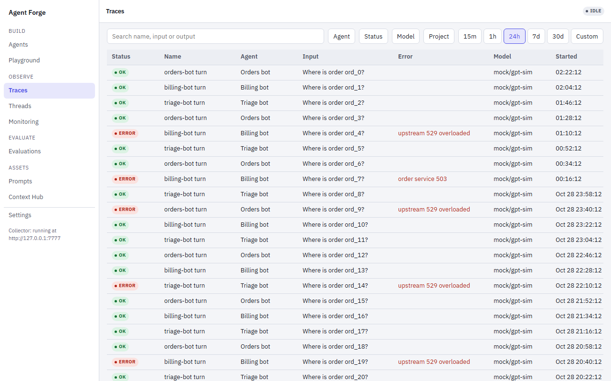

`#/traces` lists the daemon's runs, newest first: status, name, agent,
input and output previews, error message, model, start, duration, tokens
and cost (narrow windows hide the less important columns). Filter with the
search box (name, input or output), the **Agent**, **Status**, **Model** and
**Project** facets, and a time range (15m, 1h, 24h, 7d, 30d or Custom;
default the last 24 h). Click **Duration**, **Tokens** or **Cost** to sort
by it. 50 rows a page. A `prompt` filter (set by the Prompts screen's
"Runs using this version" link) shows as a removable chip.

### Trace

`#/traces/<trace id>` is one run. The header has its name, status, agent
(a link to the agent's traces), model, start, duration, tokens, cost and
session (a link to its thread), plus **Copy link**, **Add to dataset** and
**Add to queue**.

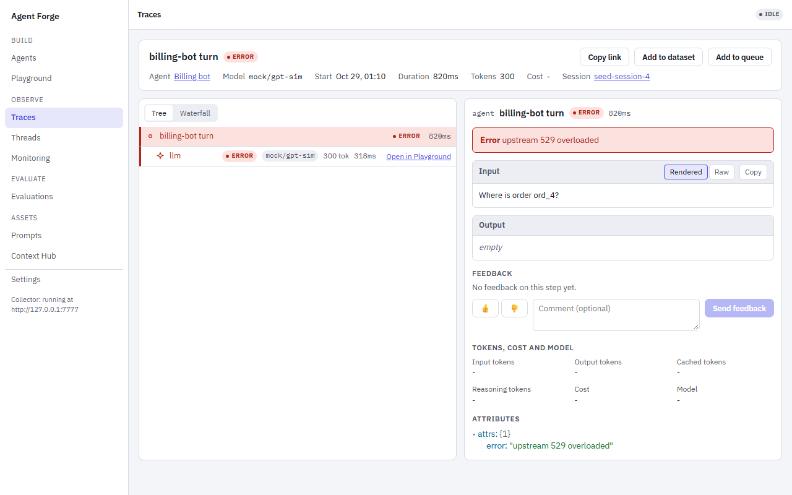

Below it is the trace viewer the builder's Trace tab and the queue review
also use: the steps as a **Tree** or a **Waterfall**, and an inspector for
the selected step (a failed step is selected by default, else the root).
The selected step is `?obs=` in the URL. The inspector shows, in order:

1. **Error**: the failure message, when the step failed.
2. **Input** and **Output**: messages render as chat bubbles with tool
   calls as chips; switch between **Rendered**, **Raw** and **JSON** (for
   JSON content), and copy either block.
3. **Feedback**: the step's scores, and thumbs up / down with an optional
   comment, saved as a `feedback` score (`1` or `0`, source `human`). On the
   root step it scores the whole trace.
4. **Tokens, cost and model**.
5. **Attributes**: the step's raw attributes as a JSON tree.

Model-call rows carry **Open in Playground**.

**Add to dataset** copies the run's input (and output, as the expected
value) into a dataset you pick, or a new one you name. **Add to queue** puts
the trace into an annotation queue for review.

### Threads

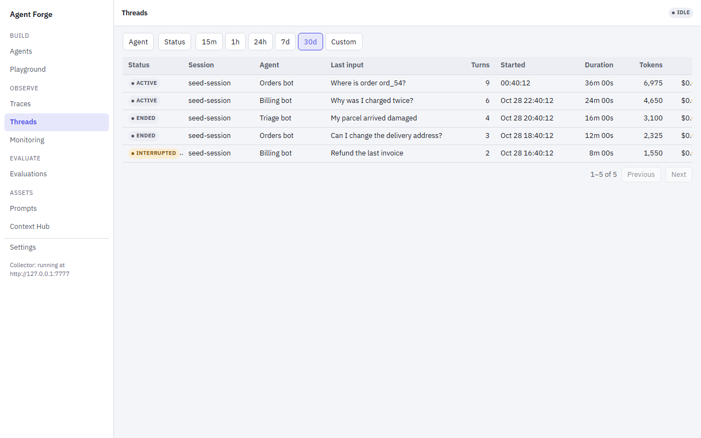

`#/threads` lists sessions: status, session id, agent, last input, turns,
start, duration, tokens and cost, filtered by agent, status and time range
(default 30 days). A session appears once agent runs carry a `sessionId`.
`#/threads/<session id>` shows the conversation: every turn (run) oldest
first, with its input and output (or error) and an **Open trace** link.

### Monitoring

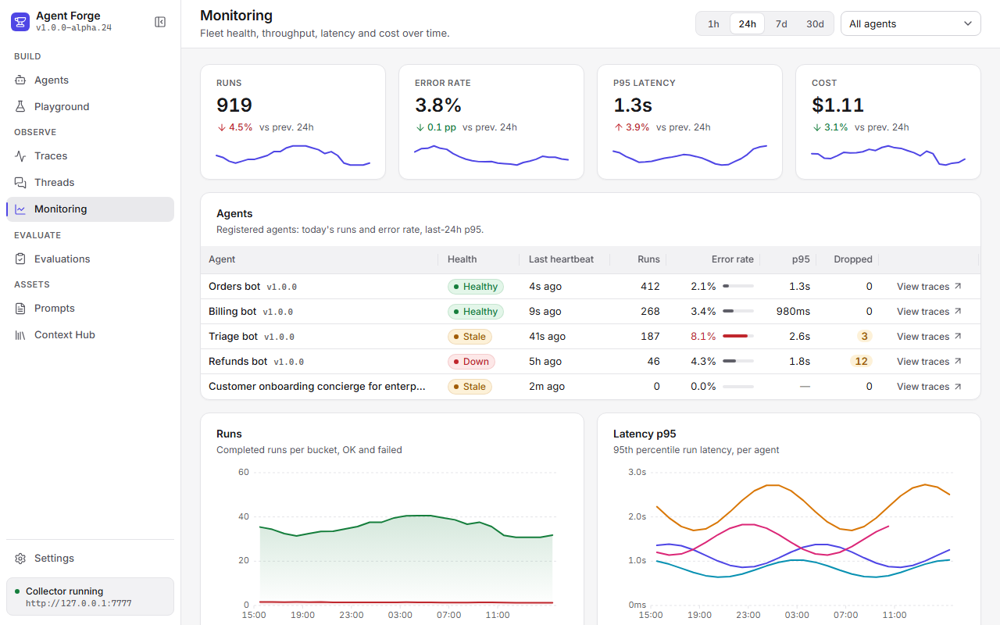

`#/monitoring` is the "is my fleet up" screen and refreshes itself every
15 seconds. The fleet table lists every agent that has reported: status,
last heartbeat, runs today, error rate, p95 latency over 24 h, the
reporter's dropped-event count and a link to its traces. Below it, pick a
window (1h, 24h, 7d, 30d) and an agent, and read five charts: **Runs**,
**Latency p95** and **Error rate** (per agent), **Cost** and **Tokens**.
Click a chart's bucket to open Traces filtered to that bucket's time (and
agent).

### Evaluations

**Evaluations** in the nav opens `#/evals/scores`. A sub-navigation at the
top of every Evaluations screen (**Scores**, **Datasets**, **Evaluators**,
**Annotation queues**) moves between them.

#### Scores

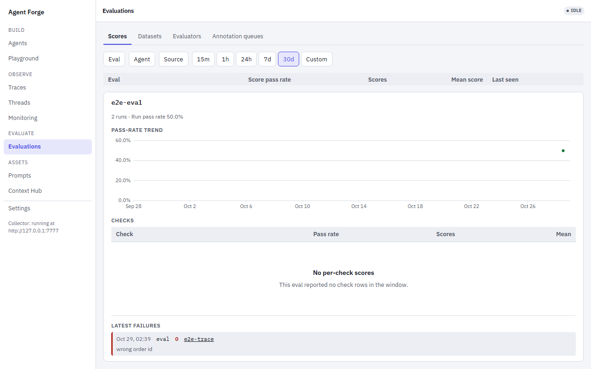

One row per eval: score pass rate, score count, mean score and last seen,
over every score of the eval (its eval-level row per run plus its check
rows). Filter by eval, agent, source (`eval`, `judge`, `human`,
`online`) and time range (default 30 days). Click an eval to expand it: the
run count and run pass rate, a pass-rate trend, the pass rate of each check
(worst first) and the latest failures, each linking to its trace (and step).
A score counts as a pass when its value is exactly 1. `eval` and `judge`
scores (an eval's assertions and its `llmJudge` / `t.judge()` checks, which
write a comment only when they fail) also pass when they have no failure
comment. `human` and `online` scores are decided by value alone, so a 0 (a
thumbs-down, a rule that returned 0), a 0.9 or an empty value is a failure.
The table and the expanded detail use the same rule.
Where eval scores come from: [Evals](./evals.md#lousho-eval).

#### Datasets

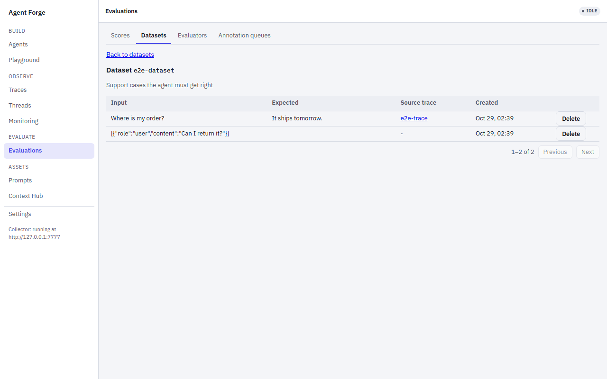

`#/evals/datasets` lists the datasets with their example counts, and has a
**New dataset** form (a name and an optional description). Open one to see
its examples (input, expected value, source trace); open an example to see
it in full, or **Delete** it (asks first). Examples come from a trace's
**Add to dataset**, or by hand through the
[datasets API](./observability.md#datasets). An eval runs over a dataset
with `defineEval({ dataset: 'name' })` (see
[Datasets](./evals.md#from-the-daemon)).

#### Evaluators

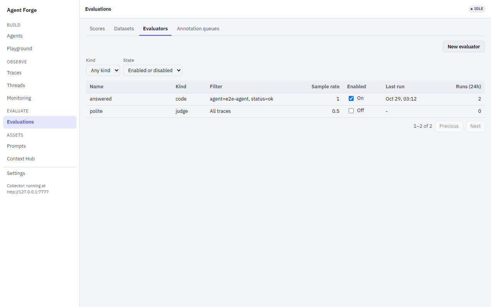

`#/evals/evaluators` manages [online evaluator
rules](./observability.md#online-evaluator-rules): rules that score new
traces as they finish. Their scores carry the rule's name and show on Scores
with source `online`.

The list shows each rule's name, kind (`code` or `judge`), filter (or "All
traces"), sample rate, an **Enabled** switch (flips the rule on or off at
once), and its **Last run** and **Runs (24h)**, counted from the newest 1000
online scores (a `+` after the count means that read was full, so the count
is a floor). Filter by **Kind** and **State** (`?kind=`, `?enabled=`), 50
rules a page.

**New evaluator** opens the form; open a rule (`#/evals/evaluators/<rule
id>`) to edit it in the same form, where **Save changes** sends only the
fields you changed and **Delete** removes the rule after a confirm (its past
scores stay). The form has a name, a sample rate (0-1), an enabled box, the
filter (agent, status `ok` or `error`, name contains), and the kind:

- A **code** rule is a function `(trace) => number | { value, comment }`,
  prefilled with a working sample. The observe daemon runs it in its isolate
  sandbox, so code rules run whether or not the Studio is open (see
  [Online evaluators](./observability.md#online-evaluators)).
- A **judge** rule is a provider, a model and a rubric. The daemon has no
  provider keys, so the Studio runs judges, with a key stored in Settings or
  the provider's environment variable where the Studio runs (the stored key
  wins); the provider list offers the providers that have either, plus
  `ollama` and `mock`. With no key at all the judge option is disabled, with
  a link to Settings. Judges run only while `lousho studio` is running; until
  then their jobs wait in the daemon (see
  [Judge rules](./observability.md#judge-rules-through-agent-forge)). Set
  `LOUSHO_STUDIO_JUDGE=0` on the Studio server to turn its judge loop off.

**Test on trace** on a rule's page dry-runs it on one trace id (`?trace=`
prefills it) and shows the value and comment; no score is written. The
Studio runs a judge rule itself and forwards a code rule to the daemon. An
unknown trace shows "Trace not found".

#### Annotation queues

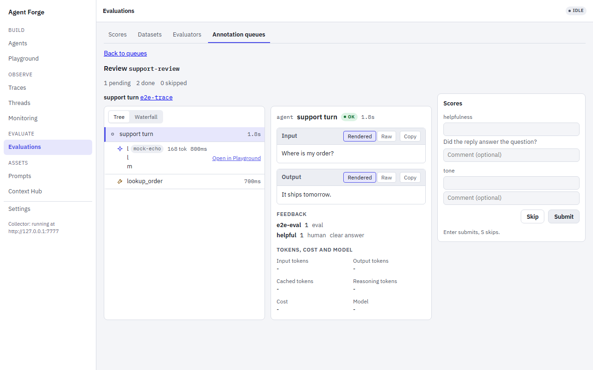

`#/evals/queues` lists the queues (pending, done, skipped) and has a **New
annotation queue** form: a name and a rubric, one row per score (name,
optional description, optional min and max). Add traces from a trace's
**Add to queue** (or many at once with the
[queue API](./observability.md#annotation-queues)). Open a queue to review
it: the next pending item's trace in the trace viewer, beside one number
input (within the rubric's bounds) and an optional comment per rubric
entry. **Submit** (Enter) saves the filled-in scores as human scores on the
trace and moves to the next item; **Skip** (`S`) skips it. A blank input is
not scored. When nothing is pending the screen says the queue is empty.

### Prompts

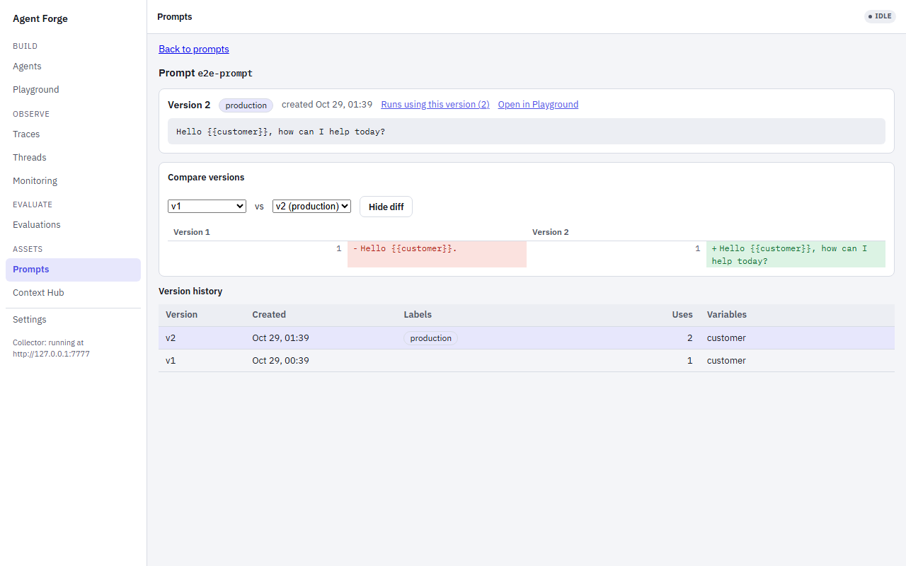

`#/prompts` lists the registry, one row per prompt: latest version, labels,
version count, runs that used it, and when it was updated; the search box
filters the list by name. Open one (`#/prompts/<name>`, or `@<version>` /
`@<label>` to select a version):

- The header: the prompt's name with the selected version's labels,
  **Runs using this version** (Traces filtered by
  `prompt=<name>@<version>`) and **Open in Playground**.
- The selected version's text, with line numbers, and **Move `<label>`
  here** for each of the prompt's labels that points elsewhere: a label
  points at exactly one version, so this moves it (the same as
  `lousho prompt label`, see [CLI](./cli.md#lousho-prompt)).
- **Compare versions**: pick two versions for a diff (`?diff=a,b`), shown
  **Unified** or **Side by side**.
- The version history, a timeline beside the text; pick a version to
  select it (`j`/`k` move between versions).

### Context Hub

`#/hub` shows the [context hub](./observability.md#the-observe-daemon)'s
namespaces. The daemon serves hub entries only on behalf of an agent, so
pick who you are **Viewing as** (default the first agent by name) and,
optionally, a scope (`private` or `fleet`). Open a namespace to see its
entries as cards (key, scope, a value preview, writer, last update and
TTL); open a card to see the full value (JSON as a tree) beside the list.
A fleet entry has an **Edit** button that republishes it (which restarts
its TTL).

### Settings

`#/settings` is one column of cards: **Appearance** (theme Light, Dark or
System, and table density Compact or Comfortable, both remembered in this
browser; until you pick a density each table keeps its screen's default),
**Provider keys**, **Settings profile**, **Deploy target**, **Collector**
(whether the observe daemon answers, its address, and `lousho observe start`
when it is down) and **Keyboard shortcuts** (the same list as the `?` sheet).
The builder drawer's **Settings** tab shows only the provider keys, profile
and deploy cards; see [Settings, secrets and deploy wiring](#settings-secrets-and-deploy-wiring).

## First-agent walkthrough

1. **Create an agent.** In the agent rail's **Agents** tab, click
   **New agent**, give it a name, and pick a starting template - **Blank graph** (a single
   LLM node using the built-in `mock` provider) is the fastest way to try
   things out without any API keys. Agent Forge creates the agent under that
   name (`.lousho/agents/<name>.yaml`, with `name: <name>` in the spec) and
   opens it on the canvas. The open agent's card has **Rename** and
   **Delete**. Rename moves the spec to the new name; earlier chats, traces
   and checkpoints stay under the old one.
2. **Look at the graph.** A blank agent is one `llm` node. Drag more nodes
   in from the rail's **Nodes** tab (**Trigger**, **LLM step**, **Tool
   call**, **Approval gate**, **Response / output**), or click (or press
   Enter on) a Nodes item to add it at the centre of the canvas, and
   connect them by
   dragging between their handles. Each node card shows its name, an LLM
   node's `provider/model` chip and tool count, and the node's status in the
   current run (`idle` until a run reaches it). Click a node to edit its
   settings (prompt, provider/model, tools, breakpoints) in the Inspector on
   the right; its **Node**, **Debug** and **Hooks** sections collapse, and
   each stays the way you left it. An agent whose canvas has no nodes shows
   the templates on the canvas: choosing one fills the canvas (unsaved until
   it autosaves, like any edit) and keeps the agent's name.
3. **Run it.** Click **Run** in the top bar. With the `mock` provider
   there's nothing to configure - it returns deterministic canned output,
   which is exactly the point for trying the rest of the UI without needing
   a real LLM API key. The status pill in the top bar tracks the run
   (`running` → `done`, `stopped` after you press **Stop**, `error` or
   `awaiting approval`), and once the run's trace id is known an **Open
   trace** link next to it opens the run at `#/traces/<traceId>` (in the
   narrow layout it is in the **More** menu). Builder runs report to the
   observe daemon as agent `<agent id>`, the same way the Playground does:
   when `LOUSHO_OBSERVE` is set its reporter is used (nothing is reported
   twice), a daemon that is down only drops events and never fails the run,
   and message content is sent only to a loopback daemon (never to the
   trace files or the live Trace tab). Run sends a fixed
   prompt, which the Chat tab shows
   as a **Run input** bubble instead of a message from you. If the studio
   server goes away, a banner says the connection was lost and the studio
   reconnects when it is back.
4. **Watch it in the debug console.** Open the bottom drawer's **Logs**
   tab for a live, filterable log feed of the run (trigger/llm/tool/
   sandbox/checkpoint/approval events), or **Trace** for the run's steps in
   the same trace viewer the Traces screen uses (a tree or a waterfall, with
   an inspector for the selected step).
   Turn on **Debug** in the top bar (or set a breakpoint on a node in the
   Inspector) to pause the run at LLM/tool boundaries and step through it
   with the debug bar's **Step**/**Continue** controls; expand "Live
   message array" there to inspect the in-flight message list. **Output**
   shows the full `ExecutionResult` (messages, tool calls, usage, steps) as
   a collapsible JSON tree once the run finishes or pauses. Drag the
   drawer's top edge (or focus it and use the arrow keys) to resize it;
   the height is remembered.

   **Trace history.** Every run is also saved as a trace file, so the
   **Trace** tab keeps the runs of the agent after the page is reloaded or the
   server restarted. A list on the left shows the agent's past runs, newest
   first (start time, duration, model calls, tokens in/out, cost, status),
   with a **Live** entry on top while a run is active; choose one to open its
   steps in the same viewer: each step's kind (model call, tool call or
   span), model, tokens and duration, failed steps in the error colour with
   the failure message in the inspector, and steps still running ticking
   live. Selecting a step highlights its node on the canvas. The list
   refreshes when a run ends. The files are the ones `lousho traces` reads, in
   `.lousho/agents/<agent id>/traces/<day>/<trace id>.jsonl` under the
   directory `lousho studio` was started in (see
   [Local traces](observability.md#local-traces)):
   `npx lousho traces --dir .lousho/agents/<agent id>/traces` shows the same
   runs in the terminal, and deleting the agent's folder deletes its traces.
   The tab shows what the spans hold: model and tool names, token counts,
   cost, durations and error messages, and in the inspector's Input,
   Output and Attributes sections the attributes, which carry prompt and
   tool content. The server reads traces only from that folder (an id with
   a path separator is a 400) and never sends the file path to the browser.
   Keep `.lousho/` out of version control.
5. **Chat with it.** The **Chat** tab is a separate conversational
   transport (`POST /agents/:id/message`, streamed back over the same
   WebSocket as everything else) - send it a message and it replies in the
   thread, independent of the graph "Run" button above. Each agent keeps
   its own chat history (`+ New chat` starts a fresh session; old ones stay
   browsable).
6. **Approve a paused tool call.** Add a **Tool call** node, open it in the
   Inspector, and pick a tool - some tools (or an agent's own policy) can
   require human approval before running. When a run or chat hits one, an
   inline approval card appears (in the top bar for a graph run, or as a
   message bubble in the Chat thread) showing the tool name and its
   arguments. Click **Approve** to let it proceed or **Reject** to abort
   that call; the run resumes automatically either way.

## Hooks

Hooks are small, sandboxed functions that run immediately before or
after a tool call or an LLM `generate` - the same mechanism the SDK core
exposes as `HookRegistry`/`AgentHook` (see
[API Overview](./api-overview.md)), but authored visually and attached to a
specific canvas node.

To attach one:

1. Select an `llm` or `tool` node on the canvas (hooks only apply to these -
   they're the two points `AgentExecutor` actually calls out to).
2. Open the Inspector's **Hooks** section. Drag a **Pre-hook** or
   **Post-hook** entry from the rail's **Nodes** tab onto the node (or drop
   it directly in the Hooks section), or click the palette entry while the
   node is selected, to attach a new one; you'll get a
   choice of starter templates (`redact-pii`, `rate-limit`, `audit-log`,
   `inject-context`) as an editable starting point.
3. Click the hook's chip to select it, then edit its code in the CodeMirror
   editor. The code is the **body** of an async function invoked as
   `hook(ctx)` inside a sandboxed subprocess (`server/hookSandbox.ts`) -
   never in the browser or the API server process itself:
   - For a tool-call hook, `ctx` is `{ toolName, args, result?, error? }`.
     A pre-hook can mutate `ctx.args`; a post-hook can inspect/mutate
     `ctx.result`/`ctx.error`. Return `ctx`.
   - For an LLM-generate hook, `ctx` is `{ messages, model }`. Mutate/push
     onto `ctx.messages` and return `ctx`.
   - **Throwing aborts the step** - a rate-limit hook, for example, throws
     to block the tool call outright rather than letting it run.
4. Toggle the switch on a hook's chip to enable/disable it without removing
   it, or use its **x** to remove it entirely. Only enabled hooks are
   compiled into the run.

Example: a redact-PII pre-hook on a tool node (this is the `redact-pii`
starter template) -

```js
const PII = /[a-z0-9._%+-]+@[a-z0-9.-]+\.[a-z]{2,}/gi;
for (const key of Object.keys(ctx.args || {})) {
  if (typeof ctx.args[key] === 'string') {
    ctx.args[key] = ctx.args[key].replace(PII, '[REDACTED]');
  }
}
return ctx;
```

Saving the agent persists these as `spec.policy.hooks` in the agent's YAML;
the server compiles enabled hooks into a real `HookRegistry` for the run
(`server/compileHooks.ts`), routed through the same `SandboxAdapter` a
sandboxed tool uses.

## Time travel

Agent Forge keeps every run's checkpoints, not just the latest: its file
store (`server/checkpointStore.ts`) keeps the same bounded history as the
SDK's `LocalStorageCheckpointStore` (the newest 50 saves per run, under
`.lousho/agents/<id>/checkpoint-history/`; see
[Checkpoint history](./durable-execution.md#checkpoint-history)). From
that history you can fork a run at any step, change what happened there,
and replay it next to the original, with
[`AgentExecutor.fork()`](./durable-execution.md#fork-and-replay) and
`compareTrajectories()` doing the work.

### The History tab

1. Run the agent (Topbar **Run**, or a Chat message).
2. Open the bottom drawer's **History** tab. It lists the run's steps:
   step number, status, the model's finish reason, the tool calls made,
   and the tokens and cost of the step's model call when known.
3. Click **Edit and replay from here** on a step. Choose **Append a user
   message** and type one, or pick one of the step's tool calls to edit
   its result (prefilled with the recorded result; text that parses as
   JSON is sent as JSON).
4. Click **Fork and replay**. The run is forked at that step with your
   edit and started as a new run, `<id>.fork-<n>`.
5. The fork opens next to the original as a side-by-side trajectory: each
   model turn of both runs (text, tool calls and results), the first turn
   where they differ highlighted as **diverged**, and the drift entries
   (tool order, arguments, step count, finish reason) listed below. It
   refreshes when the fork finishes.

### Routes

A run id is the run's checkpoint session id: the agent id for the agent's
own runs, `<id>.fork-<n>` for a fork of run `<id>`. The runtime control
server has three routes for it (the History tab uses them), and two more for
an agent's saved traces (the Trace tab uses them):

| Route | What it does |
| --- | --- |
| `GET /runs/:id/history` | `{ runId, steps }`: one entry per step of the run's latest execution (the newest checkpoint saved at that step), oldest first, with `status`, `savedAt`, `finishReason`, `toolCalls` (`{ id, name, args, result? }`), and `tokens` / `costUsd` of the step's model call when known. 404 when the run has no checkpoints. |
| `POST /runs/:id/fork` | Body `{ fromStep, patch? }`, where `patch` is `{ toolResult?: { toolCallId, result }, appendInput?, businessState? }`. Forks the run at `fromStep`, then starts the fork through the run registry with the original run's spec. Returns 202 `{ runId, fromStep, status }`; the fork streams on `WS /agents/<runId>/stream` and reports on `GET /agents/<runId>/status` like any run. 400 for a bad body or an unknown `toolCallId`, 404 for an unknown run or a step with no checkpoint. |
| `GET /agents/:id/traces?limit=N` | `{ traces }`: the agent's saved runs from `.lousho/agents/<id>/traces`, newest first (`limit` defaults to 20, at most 200), each with `traceId`, `name`, `startTime`, `durationMs`, `status`, `modelCalls`, `toolCalls`, `inputTokens`, `outputTokens` and `costUsd` when known. An agent with no runs gives an empty list; 404 for an unknown agent. |
| `GET /agents/:id/traces/:traceId` | `{ traceId, spans }`: the spans of one saved run by start time, each with `id`, `parentId`, `name`, `kind`, `status`, `startTime`, `endTime` and `attributes`. `traceId` may be a unique prefix. 400 for an id that is not letters, digits and dashes or a prefix that matches several runs, 404 for an unknown agent or trace. |
| `GET /runs/compare?a=&b=` | `compareTrajectories(a, b)` of two runs' latest checkpoints: each run's model turns, `divergedAt` (the first turn that differs) and the `drift` entries. 404 when either run has no checkpoint. |

The flow, for an agent `weather` that has run once:

```bash
# $TOKEN is the ?token= value `lousho studio` printed
curl -H "x-lousho-studio-token: $TOKEN" localhost:4750/runs/weather/history
# {"runId":"weather","steps":[{"step":1,"status":"finished","finishReason":"stop","toolCalls":[],"tokens":...}]}

curl -X POST localhost:4750/runs/weather/fork -H "x-lousho-studio-token: $TOKEN" -H 'content-type: application/json' \
  -d '{"fromStep":1,"patch":{"appendInput":"And in Celsius?"}}'
# {"runId":"weather.fork-1","fromStep":1,"status":{"status":"running",...}}

curl -H "x-lousho-studio-token: $TOKEN" 'localhost:4750/runs/compare?a=weather&b=weather.fork-1'
# {"a":[...],"b":[...],"divergedAt":2,"drift":[{"field":"steps","committed":"1","current":"2"}]}
```

The fork is a run of its own: the original run's checkpoints, status and
chat are unchanged.

## Playground run endpoint

`POST /playground/run` runs a one-off prompt against a model and streams the
reply as server-sent events. It carries the same access token as the rest of
the API. The body:

```json
{
  "messages": [{ "role": "system", "content": "You are {persona}." }, { "role": "user", "content": "Hi {name}" }],
  "variables": { "persona": "a pirate", "name": "Ada" },
  "model": "openai/gpt-4o-mini",
  "tools": ["current-date"],
  "promptRef": "greeter@prod"
}
```

- `messages` (required): 1 to 200 `{ role, content }`, `role` one of
  `system`, `user`, `assistant`. They are sent as written; the server adds no
  system prompt of its own.
- `variables`: string values. Every `{name}` in every message's content is
  replaced by `variables.name`; a placeholder with no variable is left as is.
- `model` (required): `provider/model`, or a bare provider (`mock`). The
  provider key comes from Settings > Provider keys, then the environment,
  the same way agent runs resolve it.
- `tools`: tool names the Studio resolves for agents (`current-date`,
  `day-name`, `http`, `web-fetch`, `demo-approval`). A tool that needs
  approval ends the run with `finishReason: "awaiting-approval"`; the
  playground has no approval flow.
- `promptRef`: the registry prompt the messages came from (`name`,
  `name@label` or `name@3`). It is only recorded on the trace; the server
  does not fetch the prompt.

A bad body gets `400 { error }`. Otherwise the response is `200` with
`content-type: text/event-stream`, one `data: <json>` frame per event:

| Event | Fields |
| --- | --- |
| `delta` | `text`: a chunk of the reply. |
| `tool_call` | `id`, `name`, `args`: the model called a tool. |
| `done` | `finishReason`, `text` (the whole reply), `traceId` (the run's trace in the observe daemon), `usage` when known. Last event of a run that finished. |
| `error` | `message`, `code` when it is an SDK error (`LOUSHO_PROVIDER_UNKNOWN` for an unknown provider, `LOUSHO_PROVIDER_MISSING_API_KEY`, ...). Last event of a run that failed or never started. |

Every stream ends with exactly one `done` or `error`, even a run that stops
without a result. `usage` has the `run.done` event's usage shape
(`AgentEventUsage`).

Closing the connection aborts the run. Every run reports to the observe
daemon the Studio reads (`LOUSHO_OBSERVE_URL`, default
`http://127.0.0.1:7777`, or `LOUSHO_OBSERVE` when set) as agent
`playground`, with `lousho.prompt.ref` on the run's root span when
`promptRef` is given. `LOUSHO_OBSERVE_TOKEN` is sent as the bearer token, for a
daemon bound beyond loopback. A daemon that is down does not slow or fail the run.

## Settings, secrets and deploy wiring

The Settings screen (`#/settings`, the last screen in the nav) and the builder
drawer's **Settings** tab share three parts: provider API keys
(OpenAI and Anthropic, stored encrypted under `.lousho/` and never shown
again; each key shows **Set** with its masked last characters, **From
environment** when only `OPENAI_API_KEY` / `ANTHROPIC_API_KEY` is set, or
**Not set**), named settings profiles (provider, deploy adapter, hook timeout,
OpenTelemetry toggle; kept in `.lousho/settings.json`, which holds no
secrets), and a **Deploy** section that picks an adapter (`node-server`,
`docker` or `cloudflare-worker`) and runs `lousho build` for the selected
agent. Other providers still read their environment variables, the same way
`lousho dev`/`lousho build` do (see [Configuration](./configuration.md)), and
the `mock` provider needs no credentials.

Stored keys are encrypted with AES-256-GCM in `.lousho/secrets.json`. The
encryption key is generated on first use and kept next to it in
`.lousho/secrets.key` (both `0600` on POSIX). This keeps keys out of
anything that copies the ciphertext alone - a backup, a zip of the project,
a shared agent YAML - but anyone who can read both files as your user can
decrypt them. It is not an OS keychain. Keep `.lousho/` out of version
control and out of shared archives, and prefer environment variables on
shared machines.

An agent whose provider has no key (no stored key and no environment
variable) does not run. **Run** and **Chat** fail with
`LOUSHO_PROVIDER_MISSING_API_KEY` and a message naming the fix: add the key
in Settings, set the environment variable, or switch the agent's provider to
`mock`. The studio never swaps in the mock provider on its own. The top bar's
provider pill shows the `provider/model` the agent actually runs on, and a
mock agent carries a **MOCK** badge.

## Dev mode

If you're working inside this SDK's own monorepo (contributing to Agent
Forge itself, not just using it), `lousho studio` falls back to dev mode
automatically as long as `apps/agent-forge/dist-server` hasn't been built
yet:

```bash
git clone https://github.com/LinuxDevil/agent-sdk.git
cd agent-sdk
npm install
npx lousho studio --dev   # or just `npx lousho studio` before building
```

This runs the API server straight from TypeScript (`tsx`) and a real Vite
dev server with hot-module reload for `apps/agent-forge/src/**`, as two
sibling processes. Open the printed `http://localhost:5173/?token=...` URL; Vite
is pinned to port 5173 and the API server accepts that origin. To build the production bundle used by everyone else
(and to verify what actually ships):

```bash
npm run build:studio   # builds apps/agent-forge/dist (client) and
                        # apps/agent-forge/dist-server (bundled server)
npx lousho studio       # now runs in production mode
```

`npm run build:studio` also runs automatically as part of the root
`prepublishOnly` script, so a published `npm publish` can never ship a
stale or unbuilt studio.

## E2E smoke test

`apps/agent-forge/e2e/studio.spec.ts` is a headless Playwright test that
drives the real, built `lousho studio` (the same `dist-server/index.cjs`
production server, not a dev-mode Vite server) through a browser: it
creates an agent from the "Support bot" template, retargets its tool node
at a server-local `demo-approval` tool (always `needsApproval: true` -
see `server/buildAgent.ts`'s doc comment for why this exists, since none
of the SDK's spec-resolvable built-in tools require approval), sends it a
chat message that triggers the mock provider's tool-call heuristic, waits
for the run to pause on the approval gate, approves it via the Chat tab's
inline approval card, and asserts the run completes. Run it with:

```bash
npm run test:e2e:studio   # from the repo root, or apps/agent-forge/
```

This builds Agent Forge first (`build:studio`), then runs Playwright
against it: `studio.spec.ts` above plus the other specs in
`apps/agent-forge/e2e/`, among them `revamp.spec.ts` (the revamp's
acceptance checks: a failed run's error in two interactions, every route
surviving a reload with its filters) and `a11y.spec.ts` (an axe scan of
every route in `routeTable.ts`). The daemon screens run against a fake
daemon (`e2e/observeStub.ts` and `e2e/fixtures/seedObserve.ts`), so no
`lousho observe` is needed.

### Docs screenshots

The screenshots in this doc come from `apps/agent-forge/e2e/docShots.spec.ts`,
which is skipped unless `LOUSHO_DOC_SHOTS` is set. After `npm run
build:studio`, regenerate them from the repo root with:

```bash
LOUSHO_DOC_SHOTS=1 npx playwright test -c apps/agent-forge/playwright.config.ts docShots
```

It writes `docs/images/studio-<screen>.png` (1280x800, light theme) from the
same fake daemon. The images are not part of the npm package.

Two optional variables help review a restyle before and after:
`LOUSHO_DOC_SHOTS_OUT=<dir>` writes the PNGs to another directory (absolute,
or relative to where you run the command), and `LOUSHO_DOC_SHOTS_SCHEME=dark`
shoots the dark theme (`light` is the default; any other value fails the run).

```bash
LOUSHO_DOC_SHOTS=1 LOUSHO_DOC_SHOTS_OUT=/tmp/shots-dark LOUSHO_DOC_SHOTS_SCHEME=dark npx playwright test -c apps/agent-forge/playwright.config.ts docShots
```

